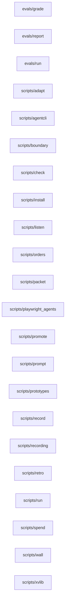

# Boundary picture

From `948efd115997` to the working tree. Source: xv boundary (ast and regex). Generated; check it against the diff.

## Shape hints

- none

## Modules

- touched: none
- added: none
- removed: none
- now calling out of the process: none

## Edges

- added: none
- removed: none



## Tables

- added: none
- removed: none

## Surface paths

- added: none
- removed: none

<details><summary>JSON</summary>

```json
{
 "base": "948efd1159971b567b82e3bc8045c8c6542e5300",
 "touched": [],
 "modules_added": [],
 "modules_removed": [],
 "edges_added": [],
 "edges_removed": [],
 "outbound_added": [],
 "tables": {
  "added": [],
  "removed": []
 },
 "surfaces": {
  "added": [],
  "removed": []
 },
 "after": {
  "modules": [
   "evals/grade",
   "evals/report",
   "evals/run",
   "scripts/adapt",
   "scripts/agentcli",
   "scripts/boundary",
   "scripts/check",
   "scripts/install",
   "scripts/listen",
   "scripts/orders",
   "scripts/packet",
   "scripts/playwright_agents",
   "scripts/promote",
   "scripts/prompt",
   "scripts/prototypes",
   "scripts/record",
   "scripts/recording",
   "scripts/retro",
   "scripts/run",
   "scripts/spend",
   "scripts/wall",
   "scripts/xvlib"
  ],
  "edges": [],
  "outbound": [
   "evals/grade",
   "scripts/boundary",
   "scripts/check",
   "scripts/listen",
   "scripts/recording"
  ]
 },
 "source": "xv boundary (ast and regex)",
 "shape_hints": []
}
```
</details>
