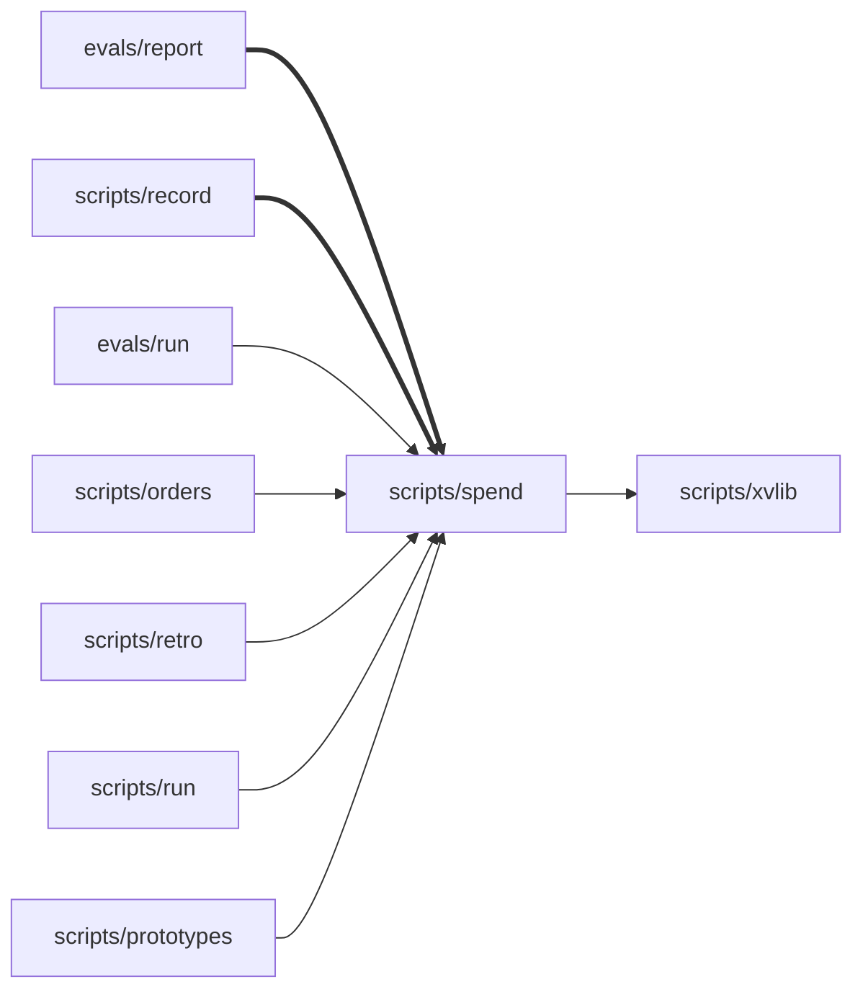

# Packet: The token cap counts the tokens that drive cost

Nothing here stops the change for two people. All three parts of your third accept-stop answer are built except half of (2): the grok test name is updated, but the grok reader's docstring is not. Sean, as originator, decides three things: accept the four moved tests, accept or wave off the docstring gap, and accept the picture edits in check 4. The merge is yours.

## The scenario

A spend row's `tokens` is input + output + cache write, with no cache reads. The record still keeps all four raw counts. One shared function, `spend.row_tokens`, counts each row, so the budget cap, the estimation guide's appender, the retro and the eval report all get the same number for the same row, including rows written before the merge. The thundercloud row from #28 counts 33,097 tokens, not 393,030. Decisions 19 and 77 and the CHANGELOG say so.

May ignore: rewriting old rows of the estimation guide; weighting tokens by price.

## The recording

None. This is a defect that starts from words. Replay the red and the green with:

`cd tests && python3 -m unittest test_token_cap_one_count test_spend test_token_cap`

- Before (the red, at `904b7a6`): `AssertionError: 'spend: 33097 tokens' not found in '... spend: 393030 tokens, $0.16, 0 s'` (from the record's `red.failure`).
- After (HEAD `ee0e6ed`): I ran it and got 14 tests, OK. The whole suite was green for the maker and the cleaner: 176 tests, OK (from the record's `checks.cleaner.suite_output`).

## The boundary picture

This is `xv boundary` from `3ca97d4f62a4` to the working tree, as given.

- Modules touched: `evals/report`, `scripts/record`, `scripts/spend`. None added or removed.
- Edges added: `evals/report → scripts/spend`, `scripts/record → scripts/spend`. None removed.
- Tables: none. Surfaces users meet: none added or removed. No new outbound calls.
- Shape hint: "an edge between modules was added".

(This is a subset of the full graph in `.xv/slices/2026-10-26-token-cap.boundary.md`. Bold edges are new.)

## What the suite asserts after

- New, in `tests/test_token_cap.py`: the budget counts the thundercloud row as 33,097 tokens and does not fire on a 150k cap. The cap still fires when input, output and cache write go over it.
- New, in `tests/test_token_cap_one_count.py`:
  - A new `spend.item` counts 33,097 tokens and keeps all four raw counts.
  - `totals` sums new items.
  - For a pre-merge row (stored `tokens` 393,030), `record.actual_by_key` and `spend.totals` both give 33,097.
  - A row with only a stored total counts that total in both.
  - `evals/report.details` prints `spend: 33097 tokens` for a pre-merge row.
- Moved, in `tests/test_spend.py`: each of the four reader tests now expects `tokens` without the cache reads. Each also asserts the reader's `cache_read` beside it (30000, 4000, 1000 + 1100, 1000). The grok test is renamed.

## 1. Shape

shape_change: no. shape_breadth: narrow. The forecast said narrow too.

- **Hint: an edge was added, `scripts/record → scripts/spend`** (`scripts/record.py:18` `from spend import row_tokens`; `:383` `k["tokens"] += row_tokens(s)`). This is not a shape change. `spend` is already a leaf that `run`, `orders`, `retro`, `prototypes` and `evals/run` import (`.xv/picture.md:21`, `:23`). It reaches only `xvlib`, so the new edge makes no cycle and no new layer. It replaces a second copy of the row count with a call to the one copy, which is what the record's second settlement asked for.
- **Hint: an edge was added, `evals/report → scripts/spend`** (`evals/report.py:12-15`, the `sys.path.insert(... "scripts")` / `from spend import row_tokens` lines). This is not a shape change. `evals/run.py:30-35` already reaches `scripts/spend` the same way. `.xv/picture.md:21` counts `evals/{run,grade,report}.py` among the 22 flat modules.
- The breadth is wider than the forecast's text ("the token-count function and its tests ... plus the cap's dollar-versus-token check") but not its shape. The extra files are `scripts/record.py`, `evals/report.py` and `docs/decisions.md`, and each came from a settlement you made at an accept stop. They do not come from the maker growing the diff on its own: after the red, the maker changed only `evals/report.py` (`git diff 904b7a6..HEAD`).
- No table, surface or outbound call was added (boundary picture, "Tables" and "Surface paths").

## 2. Pitch

pitch_contradiction: no. I checked "xv-agents makes it easy for a team or an individual to adopt Xtreme Vibing in a repo: to vibe with discipline" (`.xv/pitch.md:5`) and "Who it is not for" (`.xv/pitch.md:27`). The change counts a budget's tokens differently. It serves no new user and drops no promise. The pitch says nothing about how spend is measured.

## 3. Moved tests

`xv wall diff 2026-10-26-token-cap` reports no change since the baseline at `8e54448`. The baseline is retaken when the red is recorded, and the scenario agent's own test edits came in with that red (`git diff 8e54448 904b7a6 -- tests`). Against the slice base `3ca97d4`, four old assertions in `tests/test_spend.py` moved, and each move has a record (record front matter, `moved_tests`):

| File | Before | After | Why (the maker's record) | Forced by the scenario? |
| --- | --- | --- | --- | --- |
| `tests/test_spend.py:15` claude result | `tokens == 10+800+30000+2000+5+50+100` | `tokens == 10+800+2000+5+50+100`, plus `cache_read == 30000` | drops the 30000 cache reads | Yes. The scenario says a row's `tokens` has no cache reads. It asserts no less: the 30000 is still checked, on `cache_read`. |
| `tests/test_spend.py:18-21` grok result (renamed from `test_grok_result_adds_up_to_its_own_total`) | `tokens == 5000` | `tokens == 1000`, plus `cache_read == 4000` | 5000 included 4000 cache reads | Yes. It asserts no less: 1000 + 4000 still equals the fixture's `total_tokens` 5000 (`tests/data/grok-result.json`). The sum is implied by the two asserts, not asserted directly. |
| `tests/test_spend.py:26-27` claude session | `tokens == (3+100+1000+50)+(2+20+1100)` | `tokens == (3+100+50)+(2+20)`, plus `cache_read == 1000+1100` | drops the 1000 and 1100 cache reads | Yes. It asserts no less. |
| `tests/test_spend.py:32-35` opencode export | `tokens == 17794+304+1000` | `tokens == 17794+304`, plus `cache_read == 1000` | the 1000 was cache read | Yes. It asserts no less. |

No test changed without a record.

**Finding, half of settlement (2) not built.** The grok reader's docstring at `scripts/spend.py:66-68` is unchanged from the base: "Its input_tokens are uncached only, and its output_tokens include reasoning, so the four counts add up to its own total_tokens." It still says the four raw counts add up to `total_tokens`, which is true. It does not say that `tokens` leaves out cache reads, which your third answer asked for. In this diff, only the module docstring carries the new definition (`scripts/spend.py:12-13`: "tokens (input + output + cache write, no cache reads)"). The renamed test says more than the docstring it documents.

## 4. The picture

picture_change: yes. These are proposed edits. Accepting them is your call; I write nothing to the picture.

- `.xv/picture.md:21`, "`.xv/boundary-all.md` shows 54 edges between them": the boundary picture now lists 56. Proposed: "56 edges", and add "`record` and `evals/report` reach `spend`" after "`orders` reaches `spend` and `xvlib`."
- `.xv/picture.md:23`, "`spend` reads harness logs.": now incomplete. Proposed: "`spend` reads harness logs and owns the one per-row token count (`row_tokens`) that the budget, the guide, the retro and the eval report use."
- `.xv/picture.md:30-37`, Names: there is no line for "tokens". The record's second settlement leaves that line to the watch at the merge. Proposed: "'Tokens' in a budget, forecast, guide row or retro means input + output + cache write, with no cache reads, since 2026-10-26 (#28). Guide rows from before then counted cache reads and are not rewritten."
- `.xv/picture.md:63`, binding decision 6, "Dollars are recorded only where a harness reports them, never estimated. (`docs/decisions.md` 19, 48)": still true. The dollars sentence in decision 19 is kept word for word (`docs/decisions.md:25` hunk). No edit is needed.
- `.xv/picture.md:58`, binding decision 1, "A change to ... a standing order ... needs two people and a line in `CHANGELOG.md`": this change alters the budget order's measure. The CHANGELOG hunk (`CHANGELOG.md:7`) carries the line and says "Sean decided it, solo". The record lists `seats.two_people: solo` (`.xv/picture.md:50`), so the rule is met. No edit is needed.

Known consequence, settled and not a new finding: the guide's "actual tokens" column will now mix the old and new counts. New rows go through `row_tokens` (`scripts/record.py:383`), but old rows are kept as they are, per the may-ignore. Forecasts drawn from old rows will run high by roughly the share of cache reads, and so will the retro's 1.5× forecast check (`scripts/retro.py:68-74`). This slice's own forecast (482,000 sonnet) was made in the old count.

## Door

**Door:** two-way. Reverting the commits restores the old count. Guide rows appended in the meantime keep the new count, and a person can delete them (`.xv/estimation.md:3-5`). **Blast radius:** adopters. Every adopting repo's budget cap counts fewer tokens after it upgrades, so a budget set in the old count becomes looser. The CHANGELOG line (`CHANGELOG.md:7`) is where they learn of it.

## Raw data

- Slice record: `.xv/slices/2026-10-26-token-cap.md`
- Diff: `git diff 3ca97d4f62a4cc76d2487d83b96e9a6a7ca457e2..HEAD`. The only uncommitted change is the boundary file.
- Wall: `xv wall diff 2026-10-26-token-cap` (empty since baseline `8e54448`); `git diff 8e54448 904b7a6 -- tests` for the red's test edits
- Boundary: `xv boundary --base 3ca97d4f62a4cc76d2487d83b96e9a6a7ca457e2`, in `.xv/slices/2026-10-26-token-cap.boundary.md`
