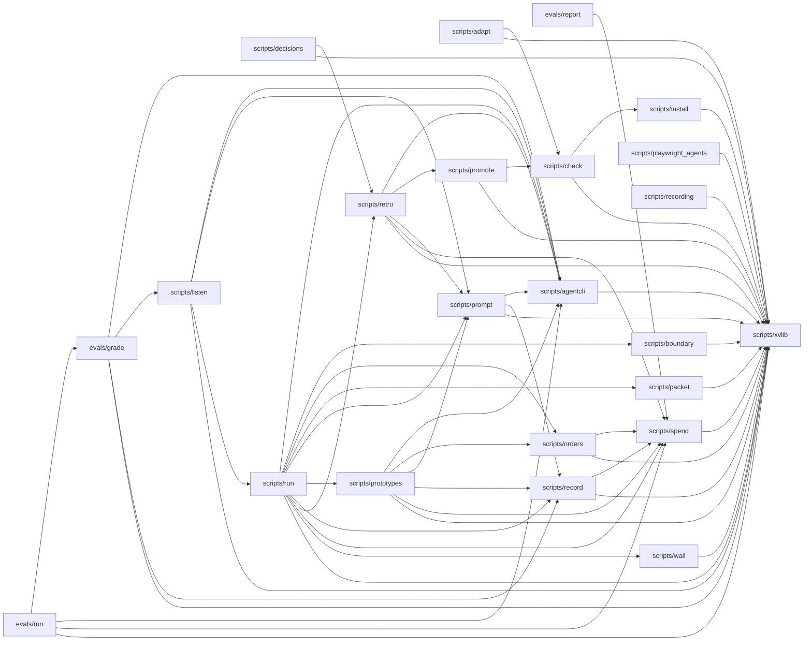

# Boundary picture

From `cafedce2750c` to the working tree. Source: xv boundary (ast and regex). Generated; check it against the diff.

## Shape hints

- none

## Modules

- touched: scripts/record
- added: none
- removed: none
- now calling out of the process: none

## Edges

- added: none
- removed: none



## Tables

- added: none
- removed: none

## Surface paths

- added: none
- removed: none

<details><summary>JSON</summary>

```json
{
 "base": "cafedce2750c9b8bfed996553f0f139df2563608",
 "touched": [
  "scripts/record"
 ],
 "modules_added": [],
 "modules_removed": [],
 "edges_added": [],
 "edges_removed": [],
 "outbound_added": [],
 "tables": {
  "added": [],
  "removed": []
 },
 "surfaces": {
  "added": [],
  "removed": []
 },
 "after": {
  "modules": [
   "evals/grade",
   "evals/report",
   "evals/run",
   "scripts/adapt",
   "scripts/agentcli",
   "scripts/boundary",
   "scripts/check",
   "scripts/decisions",
   "scripts/install",
   "scripts/listen",
   "scripts/orders",
   "scripts/packet",
   "scripts/playwright_agents",
   "scripts/promote",
   "scripts/prompt",
   "scripts/prototypes",
   "scripts/record",
   "scripts/recording",
   "scripts/retro",
   "scripts/run",
   "scripts/spend",
   "scripts/wall",
   "scripts/xvlib"
  ],
  "edges": [
   [
    "evals/grade",
    "scripts/agentcli"
   ],
   [
    "evals/grade",
    "scripts/listen"
   ],
   [
    "evals/grade",
    "scripts/record"
   ],
   [
    "evals/grade",
    "scripts/xvlib"
   ],
   [
    "evals/report",
    "scripts/spend"
   ],
   [
    "evals/run",
    "evals/grade"
   ],
   [
    "evals/run",
    "scripts/agentcli"
   ],
   [
    "evals/run",
    "scripts/spend"
   ],
   [
    "evals/run",
    "scripts/xvlib"
   ],
   [
    "scripts/adapt",
    "scripts/check"
   ],
   [
    "scripts/adapt",
    "scripts/xvlib"
   ],
   [
    "scripts/agentcli",
    "scripts/xvlib"
   ],
   [
    "scripts/boundary",
    "scripts/xvlib"
   ],
   [
    "scripts/check",
    "scripts/install"
   ],
   [
    "scripts/check",
    "scripts/xvlib"
   ],
   [
    "scripts/decisions",
    "scripts/retro"
   ],
   [
    "scripts/decisions",
    "scripts/xvlib"
   ],
   [
    "scripts/install",
    "scripts/xvlib"
   ],
   [
    "scripts/listen",
    "scripts/agentcli"
   ],
   [
    "scripts/listen",
    "scripts/prompt"
   ],
   [
    "scripts/listen",
    "scripts/run"
   ],
   [
    "scripts/listen",
    "scripts/xvlib"
   ],
   [
    "scripts/orders",
    "scripts/spend"
   ],
   [
    "scripts/orders",
    "scripts/xvlib"
   ],
   [
    "scripts/packet",
    "scripts/xvlib"
   ],
   [
    "scripts/playwright_agents",
    "scripts/xvlib"
   ],
   [
    "scripts/promote",
    "scripts/check"
   ],
   [
    "scripts/promote",
    "scripts/xvlib"
   ],
   [
    "scripts/prompt",
    "scripts/agentcli"
   ],
   [
    "scripts/prompt",
    "scripts/record"
   ],
   [
    "scripts/prompt",
    "scripts/xvlib"
   ],
   [
    "scripts/prototypes",
    "scripts/agentcli"
   ],
   [
    "scripts/prototypes",
    "scripts/orders"
   ],
   [
    "scripts/prototypes",
    "scripts/prompt"
   ],
   [
    "scripts/prototypes",
    "scripts/record"
   ],
   [
    "scripts/prototypes",
    "scripts/spend"
   ],
   [
    "scripts/prototypes",
    "scripts/xvlib"
   ],
   [
    "scripts/record",
    "scripts/spend"
   ],
   [
    "scripts/record",
    "scripts/xvlib"
   ],
   [
    "scripts/recording",
    "scripts/xvlib"
   ],
   [
    "scripts/retro",
    "scripts/agentcli"
   ],
   [
    "scripts/retro",
    "scripts/promote"
   ],
   [
    "scripts/retro",
    "scripts/prompt"
   ],
   [
    "scripts/retro",
    "scripts/spend"
   ],
   [
    "scripts/retro",
    "scripts/xvlib"
   ],
   [
    "scripts/run",
    "scripts/agentcli"
   ],
   [
    "scripts/run",
    "scripts/boundary"
   ],
   [
    "scripts/run",
    "scripts/orders"
   ],
   [
    "scripts/run",
    "scripts/packet"
   ],
   [
    "scripts/run",
    "scripts/prompt"
   ],
   [
    "scripts/run",
    "scripts/prototypes"
   ],
   [
    "scripts/run",
    "scripts/record"
   ],
   [
    "scripts/run",
    "scripts/retro"
   ],
   [
    "scripts/run",
    "scripts/spend"
   ],
   [
    "scripts/run",
    "scripts/wall"
   ],
   [
    "scripts/run",
    "scripts/xvlib"
   ],
   [
    "scripts/spend",
    "scripts/xvlib"
   ],
   [
    "scripts/wall",
    "scripts/xvlib"
   ]
  ],
  "outbound": [
   "evals/grade",
   "scripts/boundary",
   "scripts/check",
   "scripts/listen",
   "scripts/recording"
  ]
 },
 "source": "xv boundary (ast and regex)",
 "shape_hints": []
}
```
</details>
