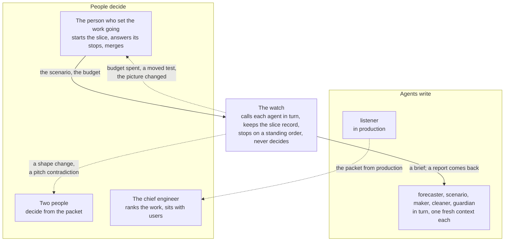
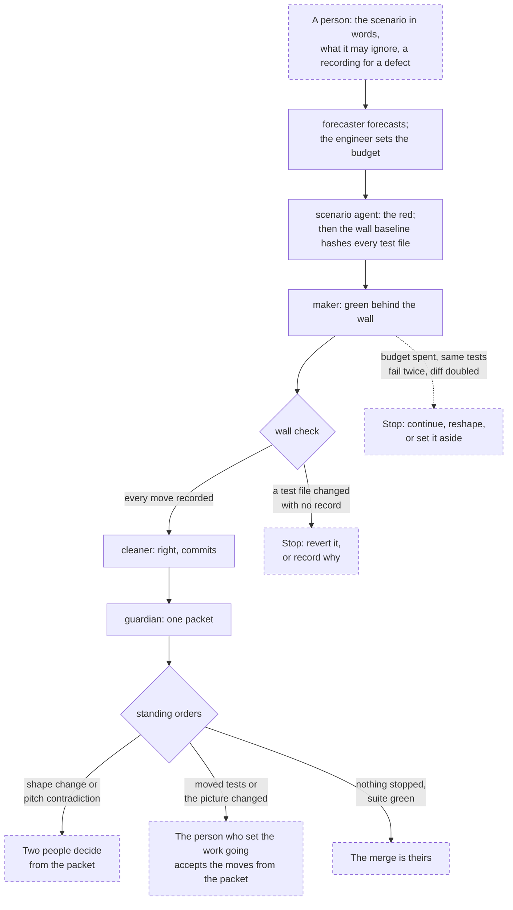
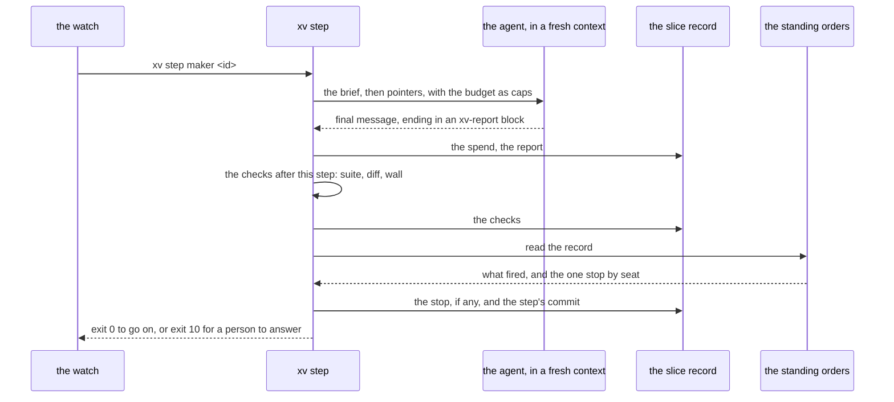
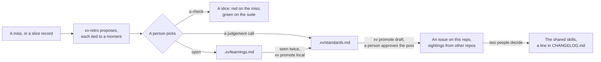

# xv-agents

Skills for the seven agents of Xtreme Vibing (XV): the watch, the forecaster, the scenario agent, the maker, the cleaner, the guardian, and the listener. Three of them work on one change: the maker, the cleaner, and the guardian. Each agent is a skill in the open Agent Skills format, a folder with a `SKILL.md`, so it is meant for any harness that reads skills. v0.1 ran on Claude Code, on Grok, and on opencode with a local model; Codex and Cursor read the same format and were not run. Beside the skills are Python scripts for the parts a check can hold, and GitHub Actions examples that run them in CI.

It is not a plugin and not any one vendor's subagent format. v0.1 was built from a plan without use. The versions after it are earned by use.

XV is the method. This repo is the mechanics: how the agents run, what they may not do, and where they hand back to a person. The method is written up at [xtremevibing.com](https://xtremevibing.com/), and its short form is below, after the words it uses.

## Contents

- [Install](#install)
- [The one rule](#the-one-rule)
- [The words](#the-words)
- [The method in brief](#the-method-in-brief)
- [The agents](#the-agents)
- [How a slice runs](#how-a-slice-runs)
- [Try it on a repo](#try-it-on-a-repo)
- [How it works](#how-it-works)
- [What the evals show](#what-the-evals-show)
- [Status](#status)
- [Credits and license](#credits-and-license)

## Install

```sh
git clone https://github.com/seanpk/xv-agents ~/src/xv-agents
python3 ~/src/xv-agents/bin/xv install
```

`xv install` links every skill into the skills folder of each agent you have installed (Claude Code, Codex, Cursor, Grok, and the shared `~/.agents`), and `xv` into `~/.local/bin`, and says if that is not on your `PATH`. It creates no folder for an agent you do not have, and never replaces a skill folder it did not make. `--into <folder>` names a skills folder instead; `--dry-run` says what it would do; `--remove` takes out what it put in. Upgrade with `git pull` in the clone: the links follow. To stay on a release, `git checkout v0.3.1` in the clone.

To give a whole team the skills through the repo instead, run `xv install --scope project` in it and commit the result. It copies the skills into the repo's agent folders (`.agents/skills` and `.claude/skills` when it has none), each with a mark of its version, so a later install replaces a copy nobody edited and refuses one somebody did, and `xv check` reports a stale or edited copy. Everyone still needs `xv` on their `PATH` from a user install. In Claude Code a person's own skill wins over the project's, and `xv check` says when both are installed.

`gh skill install seanpk/xv-agents --all` and `npx skills add` also install skills from a GitHub repo. They copy the skills but not [`bin/xv`](bin/xv), and `gh skill install --force` overwrites a local edit without warning (checked with `gh` 2.102.0, where `gh skill` is a preview; `npx skills` was not checked).

Python 3.10 or later, standard library only. The default agent CLI is Claude Code (`claude -p`); `.xv/config.yml` names a CLI per step: opencode with a local model, or Grok.

Then [try it on a repo](#try-it-on-a-repo).

## The one rule

An agent may stop. It may not decide. Ultimately, a person is responsible for what the code does, even when agents wrote all of it.

## The words

XV has its own words. This README and the method use them from here on.

| Word | What it means here |
| --- | --- |
| A slice | One change, from a scenario in words to a merge. It has its own branch, worktree and record. |
| The scenario | What must be true when the slice is done, in the words of the person who asked for it: the steps a user takes and what they see. |
| Red | The scenario made executable as a test, and shown to fail before the fix. Green is that test and every old test passing. |
| The wall | Every test that existed before the slice, hashed. A test file that changes without a recorded reason fails the wall check. |
| The packet | What the guardian writes about one change, for a person to read instead of the code: the scenario, the recording, the boundary picture, what the suite asserts after, and its five findings. The listener writes a packet from production. |
| A recording | A defect's evidence: a Playwright trace, a HAR file, or an API sequence as JSON, saved under `.xv/recordings/`. The scenario agent starts a defect's red from it. |
| The shape | The structure of the system as the team can see it: coupling, what users meet, runtime budgets. A change to it takes two people. |
| The shape conversation | People deciding the shape, in conversation. It opens when the maker's failure repeats or its diff keeps growing, and before and after a burst of work. The agent may not renovate on its own. |
| The pitch | One page in `.xv/pitch.md`: what the system does, why, and for whom. The guardian checks every change against it. |
| The picture | `.xv/picture.md`, the shared operating picture: the users, what the system is now, the decisions that bind, what is in motion. |
| The three agents | The maker, the cleaner and the guardian, three contexts on one change: make it work, make it right, find what the other two would rather not say. |
| A seat | Who answers a stop. Three seats: the person who set the work going, two people, and the chief engineer. A one-person team declares `seats.two_people: solo`. |
| The chief engineer | The person who ranks the work and sits with users. The listener's packet from production goes to them. |
| A standing order, a stop | A rule in [`scripts/orders.py`](scripts/orders.py) that reads the slice record after a step and says whether a person must answer, and in which seat. A stop ends the watch's turn until they do. |
| The door, the blast radius | Two lines in the packet, from Matt Pocock's pull request template: the door is `two-way` when a revert undoes the change and `one-way` when it does not (data migrated, a public contract changed, a message sent to users); the blast radius is one word for how much it can touch. |
| `xv-init` and `xv init` | A name with a hyphen is a skill, run by asking your agent for it. A name with a space is a command, run in a shell. The skill `xv-init` talks to you and runs the command `xv init` along the way. |

## The method in brief

Generated from the same source as the site. It states the method's positions; the agents here are the first attempt to hold them. Since v0.3.0 they have run on real changes: this repo's own slices, decided by Sean solo, and trial slices on one large Rails and TypeScript app.

<!-- xv:method begin -->
<!-- Generated on 2026-10-27 from the map at https://xtremevibing.com/map/. Edits here are overwritten at the next publish; say what is wrong in an issue on this repo. -->

The method is written up at [xtremevibing.com](https://xtremevibing.com/): [the summary](https://xtremevibing.com/), [the map](https://xtremevibing.com/map/) of values, principles and practices, [the loop](https://xtremevibing.com/loop/) one turn of delivery runs through, and [the agents](https://xtremevibing.com/agents/). This is the map in brief, as of 2026-10-27.

**Values**

- **Build for users.** Value is the experience of the person using the software. Understanding users and creating value for them is the job of everyone on the team. Work that is not for their good is refused.
- **Be empirical.** We decide from evidence of real use, not from what we expect. A decision about what the user experiences is void without a recent session with users or a packet from real use. Prototypes are run and compared, not argued. Standards are earned by misses. Budgets are corrected by what the work actually spent. The process itself is a hypothesis: we start with the best we know and refine it as we work. Everyone on the team is learning, by doing.
- **Invest in trust.** The team must trust each other and the system they use to build the system. The people who fund the software must trust the team with the product. Trust is earned, and it is necessary for speed.

**Principles**

- **Decide from evidence.** Two or more people work through the same packet and decide.
- **Lead with conviction.** One person who is accountable decides from experience, responsibility, and judgment.
- **Go and see.** Lean's genchi genbutsu: go to the real place and look at the real thing before you decide.
- **Ship at will.** The gate is released to the person. The harness sets the conditions: red before green, the test wall, the three agents, and a build that returns in minutes.
- **Own the result.** A person is responsible for the consequences of every change, including one made entirely by agents.

**Practices of the team**

- **The shared operating picture.** The team's current understanding, written down: the users, what the system is right now, and ideas for how it can better represent the vision.
- **The shape.** The structure of the system as the team can observe it: design concerns such as coupling, and runtime concerns such as response time budgets.
- **The value queue.** One person ranks the work by customer value, so the ranking is a decision and the product stays one product.
- **The pitch.** A short page in the repo: what the system does, why, and for whom.
- **Contact.** Sit with the people who use the software, or with data about how they actually use it.
- **Parallel prototypes.** For a change where the scenario does not settle the design, and a wrong design would be felt in use.
- **Attention.** A person who is too tired or spread too thin does not make the call today.

**Practices of the machine**

- **The test wall.** A scenario made executable by the scenario agent, which is never the maker, and shown to fail before the fix.
- **The budget.** A budget on the task, forecast by the forecaster with the engineer who takes it, including an expectation of shape change and its breadth (none, narrow, or wide).
- **The three agents.** Three contexts on one change. The maker makes it work behind the test wall; it may move an old test only when the scenario forces it, with a record.
- **The watch.** The agent that runs the pipeline. It knows the state of every slice, calls each agent in turn with a brief and a fresh context, keeps the log visible to anyone who needs it, and wakes a person on a standing order: the stops in the loop.
- **The fast build.** The merge waits on the pre-merge suite (the commit stage) that returns in minutes.
- **Ship.** An increment that cannot be used by a user is not done.

<!-- xv:method end -->

## The agents

| Agent | Its job | It may not |
| --- | --- | --- |
| **watch** | Runs one slice: calls each agent in turn in a fresh context, keeps the slice record, wakes a person on a standing order | Merge, rank, settle a shape, edit the pitch, raise a budget, edit its own standing orders |
| **forecaster** | Forecasts tokens, turns and dollars per harness and model from the team's estimation guide; one line on the gap at close | Set or raise a budget; edit the guide |
| **scenario** | Turns the scenario, or a defect's recording, into a test that fails before the fix | Touch source; be the maker |
| **maker** | Makes the new scenario and every old test green; moves an old test only when the scenario forces it, with a record | Weaken a test; renovate; keep going past the budget |
| **cleaner** | Fixes structure and style against the project's standards and commits | Change behaviour; add an abstraction; add or remove a standard |
| **guardian** | One packet: a shape change, a contradiction of the pitch, any old test that moved, what the change does to the picture, each finding cited | Fix, approve, or merge |
| **listener** | The packet from production: complaints, paths no story describes, where the pitch and the behaviour diverge | Rank; open issues in the value queue |

The watch sits between the people and the agents. Solid lines are work handed on. Dashed lines are a stop: the watch writes the question in the record and waits.



`xv adapt claude|opencode` optionally writes a harness's own subagent files from the skills, for a step set to `session`; `xv step` does not need it.

The person-facing skills: `xv-init` writes a starter project layer, `xv-slice` starts a slice, `xv-retro` turns misses into checks, `xv-check` reads the project layer against the core, `xv-promote` moves a learning toward these skills.

## How a slice runs

1. A person starts it: the scenario in words, what it may ignore, a recording for a defect (`xv-slice`).
2. The forecaster forecasts from the estimation guide. The engineer sets the budget: tokens, dollars and turns, as a JSON object on the record. On a repo with no closed slices the forecaster has no history and says so, and the engineer sets the first number by hand.
3. The scenario agent makes it red. The watch hashes every test file: that is the wall.
4. The maker makes it green. The wall check fails on any test file that changed without a record.
5. The cleaner makes it right and commits.
6. The guardian writes the packet. A shape change or a pitch contradiction stops it for two people. Moved tests and picture changes go to the person who set the work going.
7. Nothing stopped and the suite is green: the merge is theirs.

Each stop ends the watch's turn and waits for an answer. `xv run <id>` runs the same steps with nobody in the loop and exits with the question, so a slice can start at a desk and finish in CI.

One slice, with the checks and the stops in it. A diamond is a script that can fail the slice. A dashed box is a person.



## Try it on a repo

The whole path, on a repo that has a test suite. [Install](#install) first.

To try XV before your team commits to it, start with `xv init --trial`. It lists `.xv/` in `.git/info/exclude`, so the project layer stays on your machine and nothing about XV enters the repo's history; a slice's commits carry only the code. Everything else below works the same. If you want the layer's own history, or teammates in the trial, use `xv init --trial --repo`: `.xv/` also becomes its own git repo, which you can push to a private remote for teammates to clone into their `.xv/`. When you decide to keep it, `xv init --adopt` lets git see `.xv/` again, and you commit it. If `.xv/` is its own repo, `--adopt` refuses while that repo has uncommitted changes, then moves its history to `<git common dir>/xv-trial.git`; it deletes nothing. To drop a trial, delete `.xv/` and the `xv/*` branches.

1. Write the project layer. Ask your agent for the `xv-init` skill. It runs `xv init`, which copies the starter files into `.xv/`, detects the test command (a `src/` layout gets `PYTHONPATH=src` in front of it; a repo with several test runners gets a list to choose from), and proposes the source roots. Check both with the skill: the wall depends on the command, and the guardian sees a shape change only between modules under the roots. A suite too big to run in minutes can use a script that picks suites from the files changed since the slice's base (`XV_BASE`). Then the skill interviews you for the pitch, one sentence and then a page, and asks who decides. It ends with a review of the init itself, drafted as learnings for this repo and posted only if you approve. The pitch comes first: `xv slice new` refuses while `.xv/pitch.md` says `status: not written`. Without the skill, write the pitch by hand and set `status: written` in its front matter. If you are one person, say so; the skill sets `seats.two_people: solo`. Commit `.xv/`.
2. Open a slice. Ask your agent for `xv-slice`, or run it yourself:

   ```sh
   xv slice new 2026-10-22-expiring-today --title "Show what expires today" --by sean \
     --kind feature --scenario-file scenario.md --ignore "quantities; the mobile layout"
   ```

   The file holds the scenario in words: the steps a user takes and what they see, and for a defect what happened and what should have. The id is short and dated. The command makes the branch `xv/<id>`, a worktree under `.xv/worktrees/<id>`, and the record `.xv/slices/<id>.md` in that worktree, and prints the worktree path. `xv record show <id>` finds the record from the repo root too.
3. Set the budget. The forecaster runs first and leaves the numbers null on a fresh repo, so the first budget is yours:

   ```sh
   xv record set 2026-10-22-expiring-today budget '{"tokens": 400000, "usd": 3, "turns": 60}' --by sean
   ```

   Those are the numbers the `xv-slice` skill shows as an example. No run has yet said what a right first budget is. This changes the record in the worktree without committing it; the watch commits it with the next step.
4. Run it. Either ask your agent to "run slice 2026-10-22-expiring-today", which loads the `watch` skill, or run it headless:

   ```sh
   xv run 2026-10-22-expiring-today
   ```

   It runs step by step until a stop. Exit 10 is a stop, and the JSON on stdout says which order fired, which seat, and the question. Exit 0 with `"stop": null` means the slice closed.
5. Answer the stop and go on:

   ```sh
   xv record answer 2026-10-22-expiring-today --by sean --answer "merge" --next close --resume
   xv run 2026-10-22-expiring-today
   ```

   A stop for two people takes two names, `--by a,b`, unless the repo runs solo. The last stop on a slice that went well is `ready_to_merge`. Answer it, and the next `xv run` closes the slice: the forecaster's line on the gap, one row in the estimation guide, status `closed`. Then merge the branch yourself. The watch never merges.

## How it works

### What is in the repo

| Path | What it holds |
| --- | --- |
| `skills/<name>/SKILL.md` | One brief per agent and per person-facing skill. The body is the whole prompt of a fresh context. A skill folder may carry a second file the brief points at: the guardian's `packet.md`, the maker's `prototype.md`, xv-init's `outsider-read.md`. |
| [`bin/xv`](bin/xv), [`scripts/`](scripts/) | The mechanical parts, Python 3.10 or later, standard library only. `xv` dispatches to one script per command; `xv help` lists them. |
| [`defaults/`](defaults/) | The starter project layer that `xv init` copies into a repo's `.xv/`. |
| [`ci/github/`](ci/github/) | Three workflows to copy into an adopting repo: the wall on every pull request, the guardian's packet as a comment, the listener on a schedule. |
| [`docs/`](docs/) | The protected core ([`core.md`](docs/core.md)), why each brief says what it says ([`briefs.md`](docs/briefs.md)), the slice record's fields ([`slice-record.md`](docs/slice-record.md)), the harness doc sentences the scripts rely on ([`relies-on.md`](docs/relies-on.md)), what was checked on each harness ([`harness-notes.md`](docs/harness-notes.md)), every choice the plan left open ([`decisions.md`](docs/decisions.md)), and what was borrowed ([`borrowed.md`](docs/borrowed.md)). |
| [`evals/`](evals/) | A fixture repo, the scenarios, the runner, the grader, and the results. |
| [`tests/`](tests/) | The scripts' own tests. `cd tests && python3 -m unittest`. |

### A brief is the whole prompt

Each agent runs in a context that has never seen the others. `xv prompt <agent> <id>` builds that context's entire input: the skill's body, then pointers to this slice (the record, the base commit, the budget, the project files). Nothing is restated that the agent can read itself, with one exception: after a person answers a stop, the next agent's prompt carries that answer word for word. The same text goes to a CLI run or to a harness's own subagent.

The CLI for each step is a line in `.xv/config.yml`, a list of arguments with `{prompt}` where the text goes. The default is Claude Code in print mode with the person's own customisations off (`claude -p --safe-mode --disable-slash-commands`), so the brief is the whole user prompt. Claude Code's own system prompt stays, as opencode's does; what is gone is everything the person or the project added. A step may name a different CLI and model: Haiku for the forecaster, Opus for the guardian, a local model through opencode for the maker. A step set to `session` runs in the person's own harness as a subagent instead, with the same text.

An agent reports back in one block at the end of its final message:

```xv-report
{"agent": "maker", "status": "green", "summary": "...", "moved_tests": [...], "stop": null}
```

The watch applies the report to the slice record. A worker never edits the record itself, because a worker that edits the record can edit its own acceptance. The maker's moved tests ride in its report, and the watch saves the report before the wall reads the record. The cleaner is the one worker that commits, so it records a move first with `xv record move`; the pre-commit hook refuses a commit that moves a test with no record.

### One step




`xv step <agent> <id>` is the unit of work. It does, in order:

1. Builds the prompt and runs the agent's CLI in the slice's worktree. Every Claude step gets what is left of the budget as hard caps where the CLI has them (`--max-budget-usd` and `--max-turns` on Claude Code; the second is missing from `claude --help` in 2.1.308 and is documented and accepted).
2. Reads the spend from the harness's own output (Claude's JSON result, an opencode session export) and appends it to the record: tokens in and out, cache reads and writes, dollars where the harness reports them, turns, wall time.
3. Applies the report. A report that cannot be parsed is recorded as no report, which is a stop, not a crash.
4. Runs the checks that follow that step. They are scripts, and the results go in the record:
   - after the scenario agent: it changed only test files, and the red command fails; then the wall baseline is taken;
   - after the maker and the cleaner: the whole suite, the names of the tests that failed, the size of the diff against the base, and the wall;
   - after the cleaner: the standards file is untouched, and the fix was committed;
   - after the guardian: the packet exists, passes lint, and says `yes` or `no` to a shape change and a pitch contradiction;
   - after the forecaster and the guardian, which are read-only: nothing changed but their own output;
   - after the scenario agent, the maker and the cleaner: no file only people change was touched (the config, the pitch, the picture, the estimation guide, the rules, the wall's hashes).
5. Asks the standing orders. [`scripts/orders.py`](scripts/orders.py) reads the record and the config and returns every order that fired and the one that stops, by seat.
6. Commits what the step produced on the slice branch, so the history shows what passed the wall.

Exit 0 means go on to the next step. Exit 10 means a person must answer; the JSON on stdout says which order, which seat, and the question. A missing CLI or a failed script is an error, not a stop: the watch says what failed and does not work around it.

### The slice record

One file per slice, `.xv/slices/<id>.md`, on its own branch `xv/<id>` in a worktree under `.xv/worktrees/`. Fixed fields are front matter so scripts and CI can parse them: who set the work going, the base commit, the forecast and the budget, the red, the wall baseline, each moved test with its reason, the suite's colour, the cleaner's commit, the packet, each step's spend, each stop and who answered it, and the decisions two people made. The scenario, what it may ignore, and the log are the body. The field list is [`docs/slice-record.md`](docs/slice-record.md). `next` is the step the slice resumes at, so a slice started at a desk can be picked up in CI, or by someone else, from the record alone.

### The wall

After the scenario agent's red, `xv wall baseline` hashes every file matching the test paths in `.xv/config.yml`. After the maker and the cleaner, `xv wall check` compares. A test file that changed or disappeared with no matching entry in the record's `moved_tests` fails the check and stops the slice for the person who set the work going. The wall does not forbid a move; it forbids a silent one. The same check runs as a pre-commit hook on slice branches (`xv wall install-hook`) and in CI against the pull request's base. It reads files and the record, so it needs nothing from the harness. The eval results that are committed are from before the wall existed; the runs with it go in with the final results.

### The stops

The standing orders are code, not prose. When the steps run through `xv step`, the default, the orders run inside the script and the watch cannot skip one. A step set to `session` has the watch run `xv orders` itself afterwards, and an agent can skip a command. Each order fires on the record alone:

| The record shows | Seat |
| --- | --- |
| The budget is spent, checked before every step whether the suite is green or not | the person who set the work going |
| An old test moved with a record, or the picture changed, and the shape did not | the person who set the work going |
| A test file changed with no record | the person who set the work going |
| The same tests failed after two runs of the maker, or the diff more than doubled between two runs | the person who set the work going; the shape conversation opens |
| The scenario passed before the fix, or the scenario agent touched source | the person who set the work going |
| A worker ended with no report, or a read-only agent wrote | the person who set the work going |
| The scenario agent marked tests slice-only (`slice_only_marks`) | the person who set the work going: accept the marks, or unmark a test so it joins the wall |
| The guardian recommended which new tests join the wall or leave it | the person who set the work going, in `accept_moves`; the record keeps which they accepted |
| An agent changed a file only people change: the config, the pitch, the picture, the estimation guide, the rules, the wall's hashes | the person who set the work going |
| The maker ran in a context that had built a prototype | the person who set the work going |
| The forecaster ran and the budget is not set | the person who set the work going |
| A prototype slice has no `prototype_budgets` | the person who set the work going |
| An agent ended its step with a stop of its own: the forecaster, the scenario agent, the maker, the cleaner or the guardian asks a question | the person who set the work going; two people for a shape question |
| The cleaner's pass left the suite not green | the person who set the work going |
| The cleaner edited the standards file | the person who set the work going |
| `shape_change: yes` or `pitch_contradiction: yes` in the packet | two people |
| A budget raised past the team's limit, or a shape change wider than forecast | two people |
| Prototypes ready to pick from | two people |
| The suite is green and nothing stopped | the person who set the work going: the merge is theirs |
| The packet from production | the chief engineer; it does not wait |

A person answers with `xv record answer <id> --by <name> --answer "<their words>" --next <step> --resume`; `--settled` is required when `--next` sends the work back to the step that stopped or earlier, or the pick is `other`; three stops need none, because their work has not started: `setup_failed` saved at step `setup`, a prototype stop other than `prototypes_ready` (that pick keeps it), and a `budget_spent` stop raised before its step ran, answered with `--next` that step (not the one raised after the maker left the suite red). A stop for two people takes two names, and the script refuses one. The answer goes in the record verbatim; when two people decided, a decision record is written to `.xv/decisions/` with who took part.

A one-person team sets `seats.two_people: solo` in `.xv/config.yml`. The two-person stops still fire and still wait. One person answers them, the question asks them to write down what they weighed, and the decision record says one person decided. `xv check` lists the setting as a declared relaxation and does not fail on it.

A team can name a command in `reach:` to be told of a stop (a chat message, a page); without one, the watch says it in the session or `xv run` exits with it.

### The packet

The guardian writes `.xv/slices/<id>.packet.md`: five sections for its five checks, the fifth recommending which new tests join the wall or leave it, and a front matter with `shape_change` and `pitch_contradiction` (each `yes` or `no`), the door, and a one-word blast radius. `xv packet lint` enforces the evidence rule: a finding that cites no line, rule, project file, quoted line or diff hunk is moved to a "Dropped by the evidence rule" section, where a person can still read it, and it does not count. The boundary picture in the packet comes from `xv boundary`, not from the agent: modules and the import edges between them before and after the change, new outbound calls, tables and surface paths the diff adds or removes. It is generated so that it can be wrong in a way someone can check. A missing or malformed packet is read as `yes` to both, so the change waits for people, never for no one.

### The budget and the spend

The forecaster reads `.xv/estimation.md`, a list of closed slices keyed by harness and model, and forecasts tokens, turns and dollars for each key that has rows. It does not read the source; the guide is its evidence, and where a key has no rows it says so and leaves the number null. The person sets the budget from the forecast, and every step is capped by what is left of it. At close, the forecaster writes one line on the gap, and the watch appends one row to the guide with a script. `xv record guide-verify` fails a build where the guide was edited rather than appended.

### Headless and in CI

`xv run <id>` runs from the record's `next` to the first stop and exits 10 with the question. In CI the credentials come from a secret, so `claude -p` needs `ANTHROPIC_API_KEY`; a login session is not available there. The three workflows in [`ci/github/`](ci/github/) check out this repo at a pinned ref, put [`bin/xv`](bin/xv) on the path, and run:

- `xv wall check --base <base>` and `xv record guide-verify` on every pull request;
- `xv guard --base <base>` on every pull request, which runs the guardian on the slice record in the change, or on the bare diff when there is none, posts the packet as a comment, and fails the check only when the packet calls for two people;
- `xv listen run` on a schedule, which gathers errors, usage and feedback from the sources in the config, runs the listener, fails if the packet ranks, pushes the packet on a branch, and opens a pull request for the chief engineer when the repo lets Actions open one.

No step in any of them approves or merges. That is a promise of the workflows, not of GitHub: a workflow token can approve when the repo setting "Allow GitHub Actions to create and approve pull requests" is on, so the guardian example says to keep it off. The examples pin `v0.3.1`; upgrade by changing the ref.

### The project layer

What a team adds to shape the agents for its own system lives in `.xv/`, committed in its repo, shared by everyone on the project and every harness they use:

| File | What it holds | Who writes it |
| --- | --- | --- |
| `config.yml` | Test command and paths, source roots, the CLI per step, seats, limits, listener sources | people |
| `pitch.md` | What the system does, why, for whom | people, from an interview |
| `picture.md` | The shared operating picture: users, what the system is now, decisions that bind, what is in motion | an outsider read an agent writes, corrected and checked by a person |
| `standards.md` | The cleaner's rules, each with the miss it came from | a person accepts each one from a packet or a retro |
| `rules.md` | Facts an agent cannot infer: commands, paths, conventions | people, or a retro |
| `estimation.md` | One row per closed slice | the watch, append-only |
| `learnings.md` | Open learnings waiting for a second sighting | a retro |
| `decisions/` | What two people decided, and who | `xv record answer` |
| `slices/`, `recordings/` | The records and the packets; a defect's recordings | the watch and the agents |

It may add a rule, a fact, an example or a standing order. It may not relax the core: the contexts kept apart, the scenario agent never the maker, a test moves only with a record, the guardian's five checks, the stops, the may-not lists ([`docs/core.md`](docs/core.md)). `xv check` reports a line that reads as a relaxation, a harness file that would shadow a shared skill, every entry with the miss it came from, and a harness doc sentence a brief relied on that is gone.

The shared skills are never edited in place. An upgrade is a copy, not a merge, because every project learning is in `.xv/`. A team that must change a brief copies it under a new name, records why in `.xv/decisions/`, and accepts that the copy no longer receives upgrades.

### How the agents learn

XV's bet is that a miss turned into a check stops repeating, and a miss turned into a sentence may not. No use is behind that yet. So the main path from a miss to a rule is `xv-retro`, run after a slice that stopped, overran its budget, or drew the same guardian finding twice: a fresh context proposes candidates, each tied to a moment in a slice record, and a person picks. A check becomes a slice like any other. A judgement call becomes a line in the standards file. An Open learning seen twice is promoted inside the repo with `xv promote local`, and shared across repos as an issue on this repo with `xv promote draft` and `post`, which is the only command here that writes in public, and only with a person's approval. A change to a brief, a may-not list or a standing order takes two people and a line in [`CHANGELOG.md`](CHANGELOG.md).



### What was checked on each harness

Claude Code runs a brief as the whole prompt, reports spend in its JSON result, and refuses writes under `.git/`, which is why worktrees live in `.xv/`. opencode cannot drop its own system prompt, so the brief arrives after about 17,800 tokens of opencode's; it reports spend through `opencode session export`. codex has the flags and was not run. Playwright's test agents install without the healer, which repairs a failing test by editing it, the move the wall exists to stop. Versions, dates and what each line rests on are in [`docs/harness-notes.md`](docs/harness-notes.md); the doc sentences the scripts depend on are in [`docs/relies-on.md`](docs/relies-on.md), and a weekly workflow opens an issue here when one is gone.

## What the evals show

Every increment was built with an eval against a fixture repo ([`evals/fixture/`](evals/fixture/), a small pantry app) that has a known slice, a known defect, a known pitch contradiction, and a test the maker will want to move. Each scenario runs with the skill and without it, on Claude Code with Sonnet and on opencode with `gpt-oss:20b` on a local GPU. One run per cell, so the numbers are counts, not rates. The table, every run, and what each earlier run found are in [`evals/results/README.md`](evals/results/README.md).

The v0.1 run, all thirteen scenarios, assertions passed:

| Harness | With the skills | Without |
| --- | --- | --- |
| Claude Code, Sonnet | 80 of 84 | 43 of 73 |
| opencode, `gpt-oss:20b` | 72 of 84 | 36 of 73 |
| Grok, `grok-4.7` | 84 of 84 | 46 of 73 |

Grok always loads the person's own home rules and skills, so its baseline ran on top of one person's setup, not on a bare model.

- Without the briefs, neither model recorded a moved test, named the pitch in a review, or stopped a change for two people. With them, both did. Both arms usually made the code work; the difference is in the record and the stops.
- Without its brief, the maker changed the old test to get green and recorded nothing, on all three harnesses, and the wall check fails that. With the brief, every maker recorded the move.
- The headless watch ran a defect slice from the forecast to the packet on all three harnesses and merged nothing. On opencode the guardian ended without a report, and the watch stopped for the person instead of guessing.
- The local model was weakest as the scenario agent: from words and from a HAR file it wrote no red. Increment 1's run had two cells below their baseline, both explained in [`evals/results/inc1.md`](evals/results/inc1.md).
- Three Claude cells that missed one assertion passed in full on a rerun the same day. Small gaps here are noise.

## Status

v0.1, built 2026-10-21 and 2026-10-22; 0.2.0 came from a real init, on a real repo. Used on real slices since 2026-10-25: this repo's own, and the first trial slices on a large Rails and TypeScript app. No brief or standing order in it has been agreed by two people. What is untested is listed in [`docs/harness-notes.md`](docs/harness-notes.md); every choice the plan left open is in [`docs/decisions.md`](docs/decisions.md); the positions Sean took while it was built are in [`docs/positions.md`](docs/positions.md).

## Credits and license

MIT. The nearest neighbour to XV is Matt Pocock's `mattpocock/skills` (MIT): make it work and make it right in separate contexts, a standards file only the reviewer reads, findings that cite a rule, the door line in a pull request. Several briefs borrow from it, with credit in the brief. Everything borrowed, and from where, is in [`docs/borrowed.md`](docs/borrowed.md).
